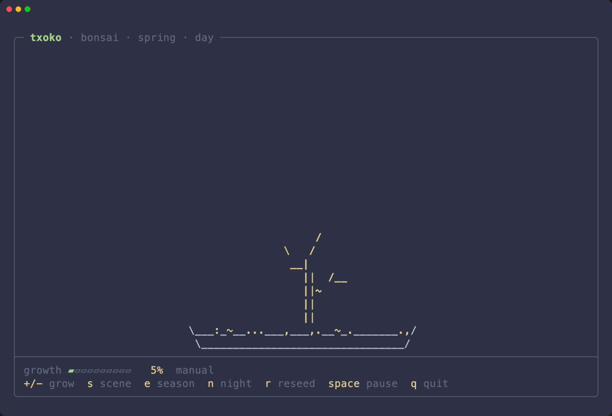
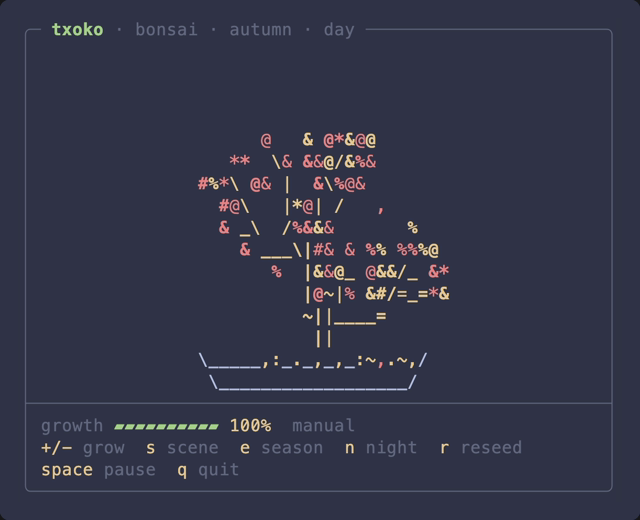
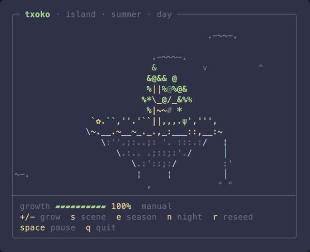
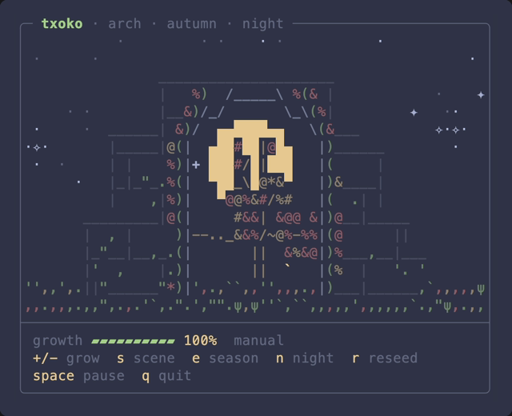
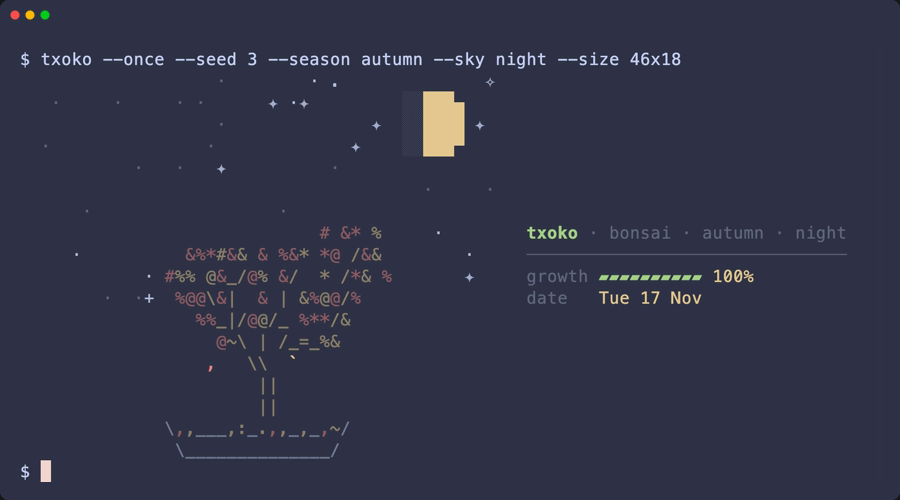
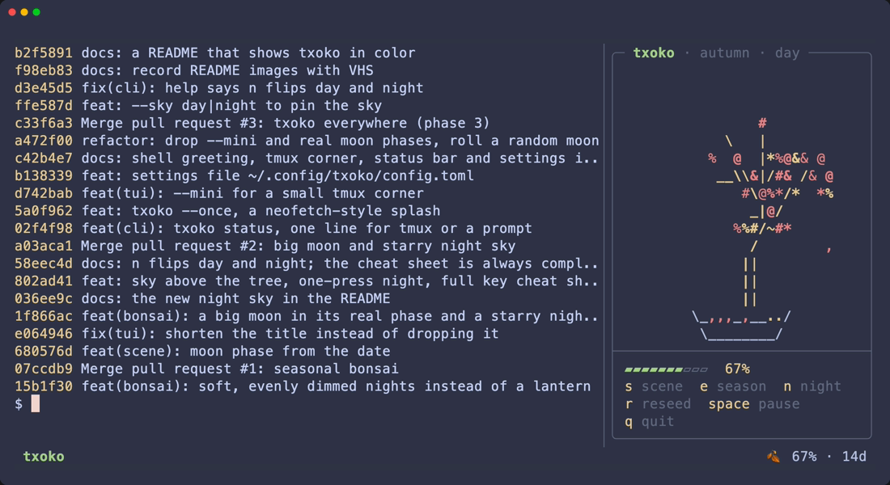
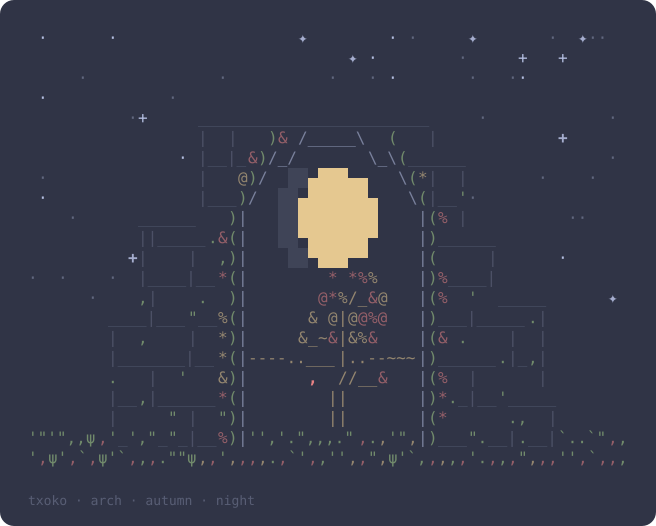

<div align="center">

# txoko

**A cozy corner for your terminal that grows as you work.**

[](https://github.com/LifeOfAitor/txoko/actions/workflows/ci.yml)
[](go.mod)
[](LICENSE)
[](https://github.com/LifeOfAitor/txoko/releases)



</div>

*Txoko* means "little corner" in Basque. It's an ambient terminal app with a bonsai that **really grows**, branch by branch: shape it by hand, let your commits and focus sessions grow it, or keep it as a quiet corner of your tmux. It dresses for the season, dims down at night under a big moon, and uses your terminal's own colors, so it fits right into your rice.

## Quick start

```sh
brew install LifeOfAitor/tap/txoko
txoko                                 # a bonsai you grow by hand: press + and -
txoko hook install && txoko --work    # or let your commits grow it
```

That's all you need. Every key is listed at the bottom of the screen; press <kbd>q</kbd> to quit.

## What you can do with it

| | | |
|---|---|---|
| 🌱 | **[Grow it by hand](#grow-it-by-hand)** | a calm toy: shape the tree, flip the season, call the night |
| 📈 | **[Let your work grow it](#let-your-work-grow-it)** | every commit makes it a little fuller |
| ⌨️ | **[Count your time at the computer](#count-your-time-at-the-computer)** | it grows on days without commits too |
| 🍅 | **[Focus sessions](#focus-sessions)** | a new tree blooms as your pomodoro runs |
| 👋 | **[A greeting in your shell](#a-greeting-in-your-shell)** | a neofetch-style scene each time you open a terminal |
| 🪟 | **[A corner of tmux](#a-corner-of-tmux)** | a narrow pane that keeps growing while you work |
| 📊 | **[Your status bar](#your-status-bar-or-prompt)** | `🍂 77% · 2d` in tmux or your prompt |
| 🖼️ | **[Share a picture](#share-a-picture)** | save your scene as an image for a README or a wallpaper |

> [!NOTE]
> txoko is young and growing fast. Star the repo to watch it grow, and [open an issue](https://github.com/LifeOfAitor/txoko/issues) if something looks off.

## Features

- 🌳 **A tree that really grows** — simulated tip by tip: the trunk climbs with an S-shaped lean, limbs reach out, twigs burst into clumps of leaves. Every machine gets its own tree.
- 🌸 **Four seasons** — cherry blossom in spring, deep greens in summer, reds and golds in autumn, a snowy crown in winter, following the calendar.
- 🌙 **Soft nights** — the tree dims, a big pixel-art moon rises, stars twinkle in four sizes and now and then a shooting star crosses the sky.
- 🍅 **Focus sessions** — `txoko --pomodoro 50` plants a seed that reaches full bloom as your session ends.
- 📈 **Grows with your work** — with `--work`, every commit and focus session makes the tree a little fuller; take a break and it slowly thins out (it never dies).
- 🖥️ **Everywhere** — a neofetch-style greeting for your shell, a corner of tmux, a line in your status bar, or a picture to share (`txoko snap`).
- 🎨 **Fits your rice** — only your terminal's 16 colors, so it matches Catppuccin, Gruvbox, Rosé Pine or whatever you run. Every key is always listed on screen.
- 🔒 **Local first** — your activity never leaves your machine.

## Seasons

<table>
  <tr>
    <td align="center"><br><sub>🌸 <b>Spring</b> · cherry blossom, petals on the breeze</sub></td>
    <td align="center"><br><sub>☀️ <b>Summer</b> · layered greens, fireflies at night</sub></td>
  </tr>
  <tr>
    <td align="center"><br><sub>🍂 <b>Autumn</b> · reds and golds, leaves falling</sub></td>
    <td align="center"><br><sub>❄️ <b>Winter</b> · a snowy crown and snowfall</sub></td>
  </tr>
</table>

## Scenes

Press <kbd>s</kbd> to switch, or start one with `--scene`. They all grow, change with the seasons and share the same night sky.

<table>
  <tr>
    <td align="center"><br><sub>🏝️ <b>island</b> · roots dangle, a waterfall starts to flow, birds come by</sub></td>
    <td align="center"><br><sub>🏛️ <b>arch</b> · ivy and moss take over the stone, the moon framed at night</sub></td>
  </tr>
</table>

There's also the flagship **bonsai** and a small **garden**.

<sub>Screenshots use the Catppuccin Frappé theme; txoko takes its colors from yours.</sub>

## Install

**Homebrew** (macOS and Linux):

```sh
brew install LifeOfAitor/tap/txoko
```

**Go** 1.27+:

```sh
go install github.com/LifeOfAitor/txoko/cmd/txoko@latest
```

**Binaries** for macOS and Linux (Intel and ARM) are on the [releases page](https://github.com/LifeOfAitor/txoko/releases).

**From source:**

```sh
git clone https://github.com/LifeOfAitor/txoko.git
cd txoko && make build
./bin/txoko
```

## Usage

### Grow it by hand

By default txoko is a visual toy: you decide how grown the scene is. All the keys are always listed at the bottom of the screen.

```sh
txoko                                    # your bonsai, as grown as you left it
txoko --scene island                     # start on another scene
txoko --season winter --sky night        # a snowy night, whatever the date
txoko --growth 1 --seed 1234             # fully grown, with a layout you like
```

| Key | Action |
|---|---|
| <kbd>+</kbd> / <kbd>-</kbd> | grow or shrink the tree |
| <kbd>s</kbd> | switch scene (bonsai, island, arch, garden) |
| <kbd>e</kbd> | cycle the season: spring → summer → autumn → winter → today's |
| <kbd>n</kbd> | switch between day and night (until you press it, the sky follows the clock) |
| <kbd>r</kbd> | plant a new tree, under a new moon |
| <kbd>space</kbd> | pause the animation |
| <kbd>q</kbd> | quit |

Every machine gets its own tree; `--seed N` picks another one, and <kbd>r</kbd> plants a new one while it runs.

### Let your work grow it

```sh
txoko hook install          # record every commit from now on
txoko import ~/code/*       # optional: bring in your last 30 days of commits
txoko --work                # the tree now grows with your activity
```

Make a commit in any repository and watch the tree grow a little within a few seconds. The footer shows today's commits and your streak.

```sh
txoko stats                 # growth, today's commits and your streak, as text
txoko import --days 90 ~/code/project   # look further back
txoko hook status           # is the hook installed?
txoko hook uninstall        # remove it again (your history is kept)
```

Take a few days off and the tree slowly thins out, but it never dies.

### Count your time at the computer

Not all work ends in a commit: writing, designing, studying, meetings. Turn on active time and the hours you spend at the computer grow the tree too.

```sh
txoko daemon install     # starts a tiny background service, now and whenever you log in
txoko daemon status      # ✓ running — 2h10 at the computer today
txoko daemon uninstall   # turn it off again (your history is kept)
```

Once a minute it asks the system how long ago you last touched the keyboard or the mouse; if it was within two minutes, that minute counts. **An hour at the computer grows the tree as much as one commit**, so a working day keeps it healthy while commits and focus sessions still weigh more. Nothing else is recorded: not which apps you use, not what you type.

It runs on macOS (launchd) and on Linux with systemd and `xprintidle` (X11).

### Focus sessions

```sh
txoko --pomodoro 50               # a new tree grows from a seed to full bloom in 50 minutes
txoko --pomodoro 25 --break 5     # classic pomodoro with a 5-minute rest
```

<kbd>space</kbd> pauses (paused time doesn't count), and quitting mid-session asks twice so a stray <kbd>q</kbd> never throws away your focus. When the time is up you get a desktop notification and <kbd>enter</kbd> plants another tree. Completed sessions also grow your `--work` tree: 25 minutes of focus count like one commit.

### A greeting in your shell

Add this to `~/.zshrc` (or `~/.bashrc`) to see your scene every time you open a terminal:

```sh
txoko --once --work
```



`--size 46x18` changes its size, and any scene flag works too (`--once --scene arch`). Without `--work` it shows a fully grown tree.

### A corner of tmux

The view adapts to narrow panes: the title shortens and the keys wrap onto extra lines, so every control stays visible.

```sh
tmux split-window -h -l 32 'txoko --work'
```



### Your status bar or prompt

Refreshed every few seconds (bottom right in the screenshot above):

```sh
# ~/.tmux.conf
set -g status-interval 10
set -g status-right '#(txoko status) '
```

`txoko status` prints `🍂 77% · 2d`. Shape it with `--format` and these placeholders:

| Placeholder | Example | What it is |
|---|---|---|
| `{icon}` | 🍂 | 🌱 or 🌿 while the tree is young, then the season's: 🌸 🌳 🍂 ❄️ |
| `{growth}` | 77 | how grown the tree is, in percent |
| `{bar}` | ▰▰▰▰▱ | the same, as a little bar |
| `{today}` | 3 | today's commits |
| `{focus}` | 50 | today's minutes of focus |
| `{active}` | 2h10 | today's time at the computer (with `txoko daemon`) |
| `{streak}` | 2 | days in a row with any activity |
| `{season}` | autumn | the season's name |

For example `txoko status --format '{icon} {bar} {today}c'` prints `🍂 ▰▰▰▰▱ 22c`.

### Share a picture

`txoko snap` saves your scene as an SVG picture: sharp at any size, for a README, a blog post or a wallpaper.

```sh
txoko snap                                              # txoko.svg, fully grown
txoko snap -o arch.svg --scene arch --season autumn --sky night
txoko snap --work -o today.svg                          # grown by your real activity
txoko snap -o - --size 80x30 > big.svg                  # any size, to stdout
```



Pictures use the Catppuccin Frappé palette, since an image can't borrow your terminal's colors.

### Settings

Save your favorite flags in `~/.config/txoko/config.toml` (or `$XDG_CONFIG_HOME/txoko/`). Flags always win over the file.

```sh
txoko config init    # writes the file with every setting explained
txoko config         # shows where it is and checks it
```

```toml
scene = "bonsai"
season = ""        # empty follows the calendar
work = true        # grow from your activity by default (--work=false to override)

[once]
size = "34x14"
work = true

[pomodoro]
break = 5          # rest after every --pomodoro session

[status]
format = "{icon} {growth}% · {streak}d"
```

A typo such as `sene = "bonsai"` is reported instead of silently ignored.

## Reference

### Commands

| Command | What it does | Example |
|---|---|---|
| `txoko` | open your scene and grow it by hand | `txoko --scene island` |
| `txoko --work` | open your scene, grown by your real activity | `txoko --work --scene arch` |
| `txoko --pomodoro M` | a focus session: a new tree blooms as the minutes pass | `txoko --pomodoro 25 --break 5` |
| `txoko --once` | print the scene once with an info panel (for `.zshrc`) | `txoko --once --work --size 46x18` |
| `txoko snap` | save the scene as an SVG picture | `txoko snap -o bonsai.svg --sky night` |
| `txoko status` | one line for tmux or your prompt | `txoko status --format '{icon} {growth}%'` |
| `txoko stats` | print growth, today's commits and your streak | `txoko stats` |
| `txoko hook install` | record every commit through a global git hook | `txoko hook install` |
| `txoko hook status` | check whether the hook is installed | `txoko hook status` |
| `txoko hook uninstall` | remove the hook (your history is kept) | `txoko hook uninstall` |
| `txoko import [dir...]` | import your recent commits (30 days, or `--days N`) | `txoko import --days 90 ~/code/*` |
| `txoko daemon install` | let your time at the computer grow it too | `txoko daemon install` |
| `txoko daemon status` | check it's running, and see today's active time | `txoko daemon status` |
| `txoko daemon uninstall` | stop it (your history is kept) | `txoko daemon uninstall` |
| `txoko config` | show where the settings file is, and check it | `txoko config` |
| `txoko config init` | create it, with every setting explained | `txoko config init` |

### Flags

| Flag | What it does | Works with |
|---|---|---|
| `--scene S` | `bonsai`, `island`, `arch` or `garden` | `txoko`, `--once`, `snap` |
| `--season S` | `spring`, `summer`, `autumn` or `winter` (default: today's) | `txoko`, `--once`, `snap` |
| `--sky S` | `day` or `night` (default: follows the clock) | `txoko`, `--once`, `snap` |
| `--growth N` | how grown it starts, from `0` to `1` | `txoko`, `--once`, `snap` |
| `--seed N` | another layout: every number is a different tree | `txoko`, `--once`, `snap` |
| `--work` | grow from your recorded commits and focus | `txoko`, `--once`, `snap` |
| `--size WxH` | the scene's size in cells | `--once` (34x14), `snap` (60x22) |
| `--pomodoro M` | a focus session of M minutes | `txoko` |
| `--break M` | rest M minutes after each session | `--pomodoro` |
| `-o FILE` | where to save the picture (`-` for stdout) | `snap` |
| `--format F` | the status line's shape | `status` |
| `--days N` | how far back to import | `import` |
| `-v`, `--version` | print the version | `txoko` |
| `-h`, `--help` | show the help | everything |

## How it works

**The tree** is simulated from a seed, tip by tip: the trunk climbs with a slow S-shaped lean, limbs reach sideways, twigs fork and burst into clumps of leaves. Growth reveals that simulation in order, so every bit of progress adds a branch or a few leaves, and growing never changes what was already there.

**Your activity** (`--work`):

- Every commit adds a point, and so does every 25 minutes of completed focus and every hour at the computer (with `txoko daemon`). Points fade with a two-week half-life, so the tree reflects your recent rhythm.
- `growth = 1 − e^(−points / 25)`: your first commits make a big difference, and about three a day keep the tree near 90%.
- The streak counts consecutive days with any activity, and stays alive until the day ends.

**Privacy and safety:**

- Everything stays on your machine, in a single SQLite file: `~/.local/share/txoko/txoko.db` (respects `XDG_DATA_HOME`, or set `TXOKO_DB`).
- Only the repository's folder name, the commit hash and its time are stored — never code, messages or paths.
- The hook points git's global `core.hooksPath` at `~/.config/txoko/hooks`. It **refuses** to replace a `core.hooksPath` you already set, and passes every hook through to each repository's own `.git/hooks`, so existing hooks keep working.
- Commits are recorded in the background: committing never gets slower.
- Repositories that set their own local `core.hooksPath` (Husky, for example) bypass global hooks; use `txoko import` for those.
- The active-time service only stores how many minutes you were at the computer each hour. It asks the system for the idle time, the same way screen savers do, and needs no special permissions. It lives in `~/Library/LaunchAgents` on macOS or `~/.config/systemd/user` on Linux, and `txoko daemon uninstall` removes it.

## Roadmap

- [x] **0 · Foundations** — project layout, tests, linting, CI
- [x] **1 · First scenes** — a growing bonsai, seasons and night skies
- [x] **2 · Real activity** — git hooks and a local SQLite store
- [x] **3 · Everywhere** — neofetch-style greeting, tmux status line and a settings file
- [x] **4 · First release** — `brew install` via a Homebrew tap
- [x] **5 · More scenes** — a floating island and a forgotten arch
- [x] **6 · Share it** — `txoko snap` saves your scene as an SVG picture
- [x] **7 · Active time** — a small background service, so time at your desk grows the tree too, not only commits

Ideas and feedback are welcome in the [issues](https://github.com/LifeOfAitor/txoko/issues).

## Development

Requires [Go](https://go.dev/dl/) 1.27+ and [golangci-lint](https://golangci-lint.run/).

```sh
make run     # build and run
make check   # format, lint and test — run before committing
make cover   # open the coverage report
make demo    # re-record the README images (needs `brew install vhs`)
make snapshot  # build a full release locally without publishing (needs goreleaser)
make help    # list every task
```

Scenes are tested with **golden files**: their expected ASCII lives in `testdata/*.golden`. After changing the art on purpose, regenerate them and review the diff:

```sh
go test ./... -update
```

The README images are recorded with [VHS](https://github.com/charmbracelet/vhs) from the scripts in [`docs/tapes`](docs/tapes).

## Releasing

See [RELEASING.md](RELEASING.md): pushing a version tag builds and publishes everything.

## License

[MIT](LICENSE)
