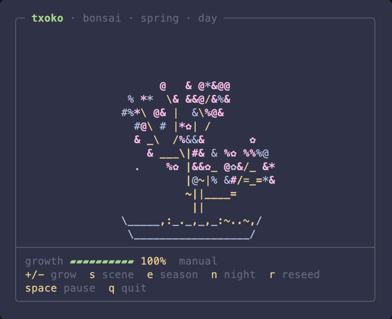
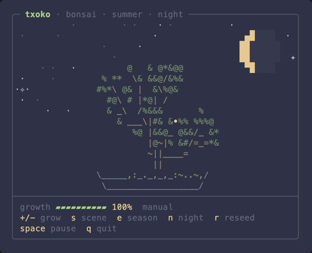
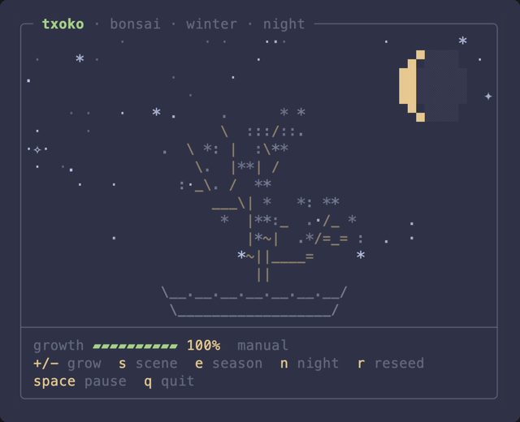

<div align="center">

# txoko

**A cozy corner for your terminal that grows as you work.**

[](https://github.com/LifeOfAitor/txoko/actions/workflows/ci.yml)
[](go.mod)
[](LICENSE)
[](https://github.com/LifeOfAitor/txoko/releases)


</div>

*Txoko* means "little corner" in Basque. It's an ambient terminal app with a bonsai that **really grows**, branch by branch: shape it by hand, let your commits and focus sessions grow it, or keep it as a quiet corner of your tmux. It dresses for the season, dims down at night under a big moon, and uses your terminal's own colors, so it fits right into your rice.

> [!NOTE]
> txoko is young and growing fast. Star the repo to watch it grow, and [open an issue](https://github.com/LifeOfAitor/txoko/issues) if something looks off.

## Features

- 🌳 **A tree that really grows** — simulated tip by tip: the trunk climbs with an S-shaped lean, limbs reach out, twigs burst into clumps of leaves. Every machine gets its own tree.
- 🌸 **Four seasons** — cherry blossom in spring, deep greens in summer, reds and golds in autumn, a snowy crown in winter, following the calendar.
- 🌙 **Soft nights** — the tree dims, a big pixel-art moon rises, stars twinkle in four sizes and now and then a shooting star crosses the sky.
- 🍅 **Focus sessions** — `txoko --pomodoro 50` plants a seed that reaches full bloom as your session ends.
- 📈 **Grows with your work** — with `--work`, every commit and focus session makes the tree a little fuller; take a break and it slowly thins out (it never dies).
- 🖥️ **Everywhere** — a neofetch-style greeting for your shell, a corner of tmux, a line in your status bar.
- 🎨 **Fits your rice** — only your terminal's 16 colors, so it matches Catppuccin, Gruvbox, Rosé Pine or whatever you run. Every key is always listed on screen.
- 🔒 **Local first** — your activity never leaves your machine.

## Seasons

<table>
  <tr>
    <td align="center"><br><sub>🌸 <b>Spring</b> · cherry blossom, petals on the breeze</sub></td>
    <td align="center"><br><sub>☀️ <b>Summer</b> · layered greens, fireflies at night</sub></td>
  </tr>
  <tr>
    <td align="center"><br><sub>🍂 <b>Autumn</b> · reds and golds, leaves falling</sub></td>
    <td align="center"><br><sub>❄️ <b>Winter</b> · a snowy crown and snowfall</sub></td>
  </tr>
</table>

<sub>Screenshots use the Catppuccin Frappé theme; txoko takes its colors from yours.</sub>

## Install

**Homebrew** (macOS and Linux):

```sh
brew install LifeOfAitor/tap/txoko
```

**Go** 1.27+:

```sh
go install github.com/LifeOfAitor/txoko/cmd/txoko@latest
```

**Binaries** for macOS and Linux (Intel and ARM) are on the [releases page](https://github.com/LifeOfAitor/txoko/releases).

**From source:**

```sh
git clone https://github.com/LifeOfAitor/txoko.git
cd txoko && make build
./bin/txoko
```

## Usage

### Shape it by hand

By default txoko is a visual toy: you decide how grown the scene is. All the keys are always listed at the bottom of the screen.

| Key | Action |
|---|---|
| <kbd>+</kbd> / <kbd>-</kbd> | grow or shrink the tree |
| <kbd>s</kbd> | switch scene (bonsai, island, arch, garden) |
| <kbd>e</kbd> | cycle the season: spring → summer → autumn → winter → today's |
| <kbd>n</kbd> | switch between day and night (until you press it, the sky follows the clock) |
| <kbd>r</kbd> | plant a new tree, under a new moon |
| <kbd>space</kbd> | pause the animation |
| <kbd>q</kbd> | quit |

Flags: `--season`, `--sky day|night`, `--growth 0..1`, `--seed N` (a layout of your choice) and `--scene`.

### Let your work grow it

```sh
txoko hook install          # record every commit from now on
txoko import ~/code/*       # optional: bring in your last 30 days of commits
txoko --work                # the tree now grows with your activity
```

Make a commit in any repository and watch the tree grow a little within a few seconds. The footer shows today's commits and your streak.

### Focus sessions 🍅

```sh
txoko --pomodoro 50               # a new tree grows from a seed to full bloom in 50 minutes
txoko --pomodoro 25 --break 5     # classic pomodoro with a 5-minute rest
```

<kbd>space</kbd> pauses (paused time doesn't count), and quitting mid-session asks twice so a stray <kbd>q</kbd> never throws away your focus. When the time is up you get a desktop notification and <kbd>enter</kbd> plants another tree. Completed sessions also grow your `--work` tree: 25 minutes of focus count like one commit.

### Everywhere: your shell, a tmux corner, your status bar

**A greeting when you open a terminal**, in `~/.zshrc`:

```sh
txoko --once --work
```


`--size 46x18` changes its size. Without `--work` it shows a fully grown tree.

**A little corner in tmux.** The view adapts to narrow panes: the title shortens and the keys wrap onto extra lines, so every control stays visible.

```sh
tmux split-window -h -l 32 'txoko --work'
```


**Your status bar or prompt**, refreshed every few seconds (bottom right in the screenshot above):

```sh
# ~/.tmux.conf
set -g status-interval 10
set -g status-right '#(txoko status) '
```

`txoko status` prints `🍂 77% · 2d`. Shape it with `--format` and the placeholders `{icon}` `{growth}` `{bar}` `{today}` `{focus}` `{streak}` `{season}`, for example `txoko status --format '{icon} {bar} {today}c'` → `🍂 ▰▰▰▰▱ 22c`.

### Settings

Save your favorite flags in `~/.config/txoko/config.toml` (or `$XDG_CONFIG_HOME/txoko/`). Flags always win over the file.

```sh
txoko config init    # writes the file with every setting explained
txoko config         # shows where it is and checks it
```

```toml
scene = "bonsai"
season = ""        # empty follows the calendar
work = true        # grow from your activity by default (--work=false to override)

[once]
size = "34x14"
work = true

[pomodoro]
break = 5          # rest after every --pomodoro session

[status]
format = "{icon} {growth}% · {streak}d"
```

A typo such as `sene = "bonsai"` is reported instead of silently ignored.

### All commands

| Command | What it does |
|---|---|
| `txoko` | open your scene and grow it by hand |
| `txoko --work` | open your scene, grown by your real activity |
| `txoko --pomodoro M [--break M]` | focus session: a new tree blooms as the minutes pass |
| `txoko --once [--work]` | print the scene once with an info panel (for `.zshrc`) |
| `txoko status [--format F]` | one line for tmux or your prompt |
| `txoko config [init]` | show or create the settings file |
| `txoko hook install` | record every commit through a global git hook |
| `txoko hook uninstall` | remove the hook (your history is kept) |
| `txoko hook status` | check whether the hook is installed |
| `txoko import [dir...]` | import your commits from the last 30 days (`--days N`) |
| `txoko stats` | print growth, today's commits and your streak |

## How it works

**The tree** is simulated from a seed, tip by tip: the trunk climbs with a slow S-shaped lean, limbs reach sideways, twigs fork and burst into clumps of leaves. Growth reveals that simulation in order, so every bit of progress adds a branch or a few leaves, and growing never changes what was already there.

**Your activity** (`--work`):

- Every commit adds a point, and so does every 25 minutes of completed focus. Points fade with a two-week half-life, so the tree reflects your recent rhythm.
- `growth = 1 − e^(−points / 25)`: your first commits make a big difference, and about three a day keep the tree near 90%.
- The streak counts consecutive days with any activity, and stays alive until the day ends.

**Privacy and safety:**

- Everything stays on your machine, in a single SQLite file: `~/.local/share/txoko/txoko.db` (respects `XDG_DATA_HOME`, or set `TXOKO_DB`).
- Only the repository's folder name, the commit hash and its time are stored — never code, messages or paths.
- The hook points git's global `core.hooksPath` at `~/.config/txoko/hooks`. It **refuses** to replace a `core.hooksPath` you already set, and passes every hook through to each repository's own `.git/hooks`, so existing hooks keep working.
- Commits are recorded in the background: committing never gets slower.
- Repositories that set their own local `core.hooksPath` (Husky, for example) bypass global hooks; use `txoko import` for those.

## Roadmap

- [x] **0 · Foundations** — project layout, tests, linting, CI
- [x] **1 · First scenes** — a growing bonsai, seasons and night skies
- [x] **2 · Real activity** — git hooks and a local SQLite store
- [x] **3 · Everywhere** — neofetch-style greeting, tmux status line and a settings file
- [x] **4 · First release** — `brew install` via a Homebrew tap
- [ ] **5 · More scenes** — landscapes that grow, plus custom scenes from config
- [ ] **6 · Your year** — a landscape built from your GitHub contribution calendar
- [ ] **7 · Activity daemon** — active-time tracking as a background service
- [ ] **8 · MCP server** — ask your AI assistant about your progress
- [ ] **9 · Image to ASCII** — turn wallpapers into scene backgrounds

## Development

Requires [Go](https://go.dev/dl/) 1.27+ and [golangci-lint](https://golangci-lint.run/).

```sh
make run     # build and run
make check   # format, lint and test — run before committing
make cover   # open the coverage report
make demo    # re-record the README images (needs `brew install vhs`)
make snapshot  # build a full release locally without publishing (needs goreleaser)
make help    # list every task
```

Scenes are tested with **golden files**: their expected ASCII lives in `testdata/*.golden`. After changing the art on purpose, regenerate them and review the diff:

```sh
go test ./... -update
```

The README images are recorded with [VHS](https://github.com/charmbracelet/vhs) from the scripts in [`docs/tapes`](docs/tapes).

## Releasing

See [RELEASING.md](RELEASING.md): pushing a version tag builds and publishes everything.

## License

[MIT](LICENSE)
